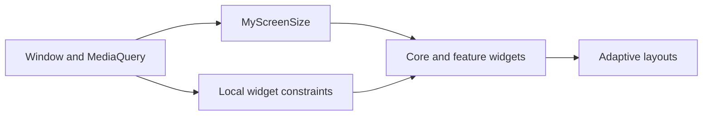

# Requirements

### Goal
Make the existing Bilhikma Flutter UI usable across iOS and Android phones, tablets, orientations, and constrained window sizes, using `lib/core/utils/my_screen_size.dart` as the existing device-size and scaling API.

### Scope
- Audit and adapt all routed app screens and shared UI surfaces, prioritizing shared components and screens whose layout changes materially across widths/heights.
- Support the helper’s compact (`<600 dp`), medium (`600–839 dp`), and expanded (`>=840 dp`) classes, while using local constraints where a component’s available width differs from the whole window.
- Preserve the current visual design and behavior at the existing 412×917 dp baseline.
- Cover safe areas, keyboard appearance, portrait/landscape, Arabic RTL, and enlarged text where relevant.

### Acceptance Criteria
- No unintended overflow, clipped controls/text, or unusable tap targets across phone, tablet, and split-view test sizes.
- Wide layouts use bounded content widths or deliberate multi-column arrangements rather than stretching phone layouts across tablets.
- Compact layouts retain readable content and working forms, navigation, dialogs, and media controls.
- Existing responsive behavior and tests remain intact; validation includes Flutter tests and `flutter analyze`.

### Out of Scope
- Desktop and web layout support, backend/state-management changes, and a new responsive dependency.
- Blindly replacing every fixed dimension with proportional scaling; structural layout changes should use constraints and breakpoints.

# Technical Design

### Current Implementation
- `lib/core/utils/my_screen_size.dart` already defines `WindowSize` and `windowSize()` breakpoints (lines 4, 37–41), tablet detection (34–35), safe-area/keyboard/text-scaling accessors (23–30), responsive `w/h/r/sp` scaling (67–83), and bounded fraction helpers (89–103).
- `lib/core/utils/screen_scale.dart` exposes the helper as `.w(context)`, `.h(context)`, `.r(context)`, and `.sp(context)` extensions. These are already widely used, but explicit window-class branching is uncommon.
- `lib/bilhikma_app.dart:48–50` wraps the app in `ResponsiveDesignCanvas`, whose current implementation (`lib/core/widgets/responsive_design_canvas.dart:3–11`) simply invokes its builder.
- `lib/features/main_shell/presentation/widgets/main_shell_view.dart:34–54, 62–91` is an existing local adaptive-layout example: it switches at 600 dp, uses a navigation rail on wide windows, and caps content width at 1040 dp.
- Existing regression coverage in `test/bottom_nav_responsive_test.dart:10–15` and `test/responsive_content_test.dart:33–123` covers phone, iPad portrait/landscape, iPad split-view, adaptive gallery columns, and bounded section content.
- The project has 30 feature screen entry points. `pubspec.yaml` does not declare `corereusablepackage` or `flutter_screenutil`, and no sibling reusable package is present; use the project’s existing core widgets and Flutter layout primitives.

### Key Decisions
- **Local adaptive ownership:** Keep layout decisions in the affected screen/widget, using its `LayoutBuilder` constraints for structural changes and `MyScreenSize` for window classes, device metrics, and design-relative dimensions. This follows `MainShellView` and avoids a new global layout contract.
- **Scale selectively:** Use `w/h/r/sp` only for design-measured dimensions; prefer `Flexible`, `Wrap`, scroll views, bounded widths, and responsive grids for layout. Clamp or cap dimensions that should not grow with tablet width.
- **Preserve accessibility and platform behavior:** Review the interaction between `MyScreenSize.textScaler`, `AppChrome`’s fixed text-scale configuration, and app font preferences; verify keyboard insets, safe areas, and RTL without introducing a second scaling layer.
- **No new shared package or dependency:** Adapt existing widgets in `lib/core/widgets/` and feature presentation widgets; keep UI rendering-only and preserve the current Cubit/data-source boundaries.

### Proposed Changes
Audit the shared UI and all routed feature screens for fixed widths/heights, overflow-prone rows/columns, oversized scaling on tablets, keyboard obstruction, and orientation-specific media layouts. Apply responsive structure only where needed, retain the established phone design, and add widget tests following the repository’s current viewport-sizing patterns.

### File Structure
- Keep `lib/core/utils/my_screen_size.dart` as the required source for responsive metrics; change it only if the audit identifies a concrete helper gap or defect.
- Adapt relevant shared surfaces under `lib/core/widgets/`, `lib/core/drawer/presentation/`, and `lib/core/services/videoplayerservice/widgets/`.
- Adapt feature UI in `lib/features/<feature>/presentation/` (screens, `refactor/`, and widgets), including the shell and high-use content, form, quiz, and media flows.
- Extend `test/responsive_content_test.dart` and `test/bottom_nav_responsive_test.dart`, adding focused widget tests for other affected surfaces as needed.

### Architecture Diagram

### Risks
- Proportional `w/h/sp` values can make tablet layouts too large; use window-class branches, max widths, and component-local constraints instead of treating scale as a complete responsive strategy.
- Keyboard, notches, split-view, and landscape can reduce usable space without changing the app’s feature state; verify scrollability and insets at those sizes.
- Global font-scale clamping in `AppChrome` may interfere with platform text scaling; preserve intended app preferences while ensuring larger text remains readable.

# Testing

### Validation Approach
- Follow the existing `WidgetTester.view.physicalSize` setup in `test/responsive_content_test.dart` and `test/bottom_nav_responsive_test.dart` to render affected widgets at representative logical viewport sizes.
- Verify no Flutter layout exceptions, overflow indicators, clipped key content, or controls outside the viewport; verify expected columns, navigation mode, and content-width caps.
- Run the applicable widget tests, the full `flutter test` suite, and `flutter analyze` after implementation; no `build_runner` work is expected unless a future change introduces generated code.

### Key Scenarios
- Compact phone: 320×568 and 390×844 dp.
- Medium/tablet or constrained window: 600×900, 820×1180, and 507×744 dp split view.
- Expanded tablet/landscape: 1180×820 dp and a landscape phone viewport.
- Text scaling and RTL: validate long localized labels and larger text alongside keyboard-visible form layouts.
- Shared navigation, dialogs/sheets, grids/lists, lesson/test views, and media controls remain usable at their target sizes.

# Delivery Steps

### * Step 1: Audit responsive primitives and shared chrome
The app has a verified responsive baseline and shared chrome surfaces that follow the selected local-layout approach.
- Review `MyScreenSize` and `screen_scale.dart` usage to identify dimensions that should remain fixed, scale, clamp, or branch by window class.
- Audit `bilhikma_app.dart`, `app_chrome.dart`, `responsive_design_canvas.dart`, theme text scaling, and safe-area behavior; retain local ownership rather than introducing a central responsive scope.
- Add or update focused helper/chrome tests only where the current behavior requires correction, including compact/medium/expanded boundaries.

###   Step 2: Adapt shared navigation and reusable UI
Shared navigation, drawer, dialog, sheet, and common content widgets adapt to compact and wide constraints without changing their behavior.
- Use `MainShellView` as the established wide-layout precedent and inspect shared surfaces in `lib/core/widgets/`, `lib/core/drawer/presentation/`, and video-player widgets.
- Fix overflow-prone fixed dimensions with local constraints, bounded widths, `Wrap`/flex layouts, scrollability, and selective `MyScreenSize` helpers.
- Extend responsive widget coverage for phone, iPad portrait/landscape, and split-view sizes; assert no layout exceptions and expected navigation/content bounds.

###   Step 3: Adapt primary feature screens and content flows
Authentication, home, learning, discovery, and account screens remain readable and operable across supported phone and tablet sizes.
- Audit screens and presentation widgets under `lib/features/auth/`, `home/`, `subjects/`, `subject_content/`, `lessons/`, `lesson_detail/`, `search/`, `gallery/`, `archive/`, `profile/`, `settings/`, and notifications/update flows.
- Rework only layouts that need structural adaptation, including forms, long text, cards/lists, and tablet grids; preserve existing Cubit and navigation responsibilities.
- Add representative widget tests for narrow phones, tablet portrait/landscape, RTL labels, and enlarged text on the highest-risk shared and feature surfaces.

###   Step 4: Adapt specialized test and media layouts
Quiz, PDF, image, live-video, and other height-sensitive experiences remain usable in landscape, with system insets, and when the keyboard or controls reduce available space.
- Audit `lesson_test`, `textbooks`, `live_sessions`, `gallery_viewer`, and shared video-player/image-viewer widgets for fixed-height assumptions and clipped controls.
- Use local viewport constraints and scroll behavior for structural changes; preserve intended full-screen media layouts where a content-width cap would be harmful.
- Extend responsive tests for short/landscape viewports and insets, then run `flutter test` and `flutter analyze`; document that no `build_runner` generation is expected unless generated files become necessary.